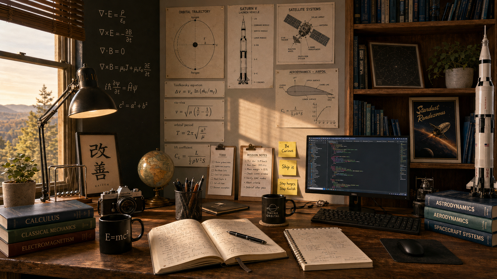

<p align="center">
  
</p>

<h1 align="center">Vitor Hugo da Silva</h1>

<p align="center">
  <strong>Robotics & Software Developer</strong>
</p>

<p align="center">
  <strong>C# / .NET · ROS 2 · C++ · Python · Linux · R&D&I</strong>
</p>

<p align="center">
  Building software that connects industrial systems, robotics and the physical world.
</p>

<p align="center">
  <a href="https://github.com/ViktorWalde">
    
  </a>
  <a href="https://www.linkedin.com/in/vitor-hugo-da-silva-54359b312/">
    
  </a>
  <a href="https://viktorwalde.github.io/KineinSite/">
    
  </a>
</p>

---

## About Me

I'm a software developer from Paraná, Brazil, and an undergraduate student in **Systems Analysis and Development at PUCPR**.

My work brings together two areas that I want to keep developing in parallel:

- **Robotics and R&D&I:** I am an R&D&I scholarship fellow at a **SENAI Institute of Technology**, developing practical knowledge in robotics, ROS 2, automation and integration with physical systems.
- **C# and software engineering:** I have professional experience developing **industrial production-management software in C#**, including desktop interfaces and integration with devices and production data.

I am particularly interested in engineering problems that require both reliable software and an understanding of the equipment, processes and people it serves.

## What I Focus On

### Robotics & Industrial Automation

My current robotics work and studies include:

- Industrial robot programming, manipulation sequences and gripper integration.
- **ROS 2** applications with C++ (`rclcpp`) and Python (`rclpy`).
- Nodes, topics, services, actions and distributed robotic communication.
- Coordinate frames, TF2, URDF/Xacro and visualization with RViz2.
- Sensor integration, actuators and the software/hardware interface.
- Prototyping, testing and validation in an R&D&I environment.

### C# / .NET & Industrial Software

My software engineering focus includes:

- **C# and .NET** for desktop applications and application logic.
- Production-management workflows and industrial software interfaces.
- Integrating software with devices and manufacturing data.
- Designing maintainable services, data models and APIs.
- Connecting **shop-floor systems (OT/TA)** with business and information systems (IT/TI).

I'm also exploring the architecture of **MES, OEE monitoring, PLC data acquisition and industrial telemetry** as a direction for future software products.

## Engineering Perspective

I enjoy working across the layers between physical processes and software applications:

```text
      Robots · PLCs · Sensors
                 │
                 ▼
     Robotics / Device Integration
        ROS 2 · C++ · Python
                 │
                 ▼
        Industrial Software
             C# / .NET
                 │
                 ▼
    Production Management · Monitoring
            Data · Insights
```

These layers can be independent systems; the diagram represents the kind of end-to-end integration problems I want to solve.

---

## Featured Open-Source Project

### [Kinein Vectis](https://github.com/ViktorWalde/KineinVectis)

**A Linux-first, open-source IDE for C, C++, Rust and Python development.**

Kinein Vectis is my independent software engineering project. It focuses on making development environments easier to understand and control by integrating existing compilers, build tools, language servers, debuggers and embedded toolchains.

- **Architecture:** Qt/QML frontend with a Rust core.
- **Ecosystems:** C/C++, Rust, Python, Linux and embedded development.
- **Engineering focus:** tooling integration, explicit configuration, build/debug workflows and developer experience.

**Latest public beta verified:** `v0.3.5` (October 2026).

[Repository](https://github.com/ViktorWalde/KineinVectis) · [Download public beta](https://github.com/ViktorWalde/KineinVectis/releases/tag/v0.3.5) · [Website & documentation](https://viktorwalde.github.io/KineinSite/) · [Community](https://discord.gg/cWRkUGUmQU)

> The IDE's current focus is systems and embedded development. Robotics tooling is an area of interest, not a claim of full ROS 2 integration in the released version.

---

## Technical Toolkit

| Area | Languages, tools & technologies |
| --- | --- |
| **Software Engineering** | C#, .NET, desktop applications, APIs, SQL, Git |
| **Robotics** | ROS 2, C++, Python, `rclcpp`, `rclpy`, RViz2, TF2, URDF |
| **Systems & Embedded** | C, C++, Rust, Linux, CMake, Cargo, GDB |
| **Industrial Integration** | Device communication, IoT/IIoT, MQTT, industrial telemetry |
| **Development Tools** | GitHub, Docker, Qt/QML, testing and debugging |

## Currently Learning & Exploring

- More advanced **ROS 2** development, robot modeling and coordinate transformations.
- Industrial and mobile robotics, control and sensor integration.
- **C#/.NET architectures** for scalable industrial and production software.
- PLC communication, production indicators and **OEE/MES** concepts.
- Embedded Linux and systems programming when they support robotics or automation problems.

## Let's Connect

I'm interested in collaborating on **robotics, industrial automation, C#/.NET software and applied R&D&I**.

[GitHub](https://github.com/ViktorWalde) · [LinkedIn](https://www.linkedin.com/in/vitor-hugo-da-silva-54359b312/)

<p align="center">
  <strong>Robotics · C#/.NET · ROS 2 · Industrial Software</strong>
</p>

<p align="center">Paraná, Brazil</p>
